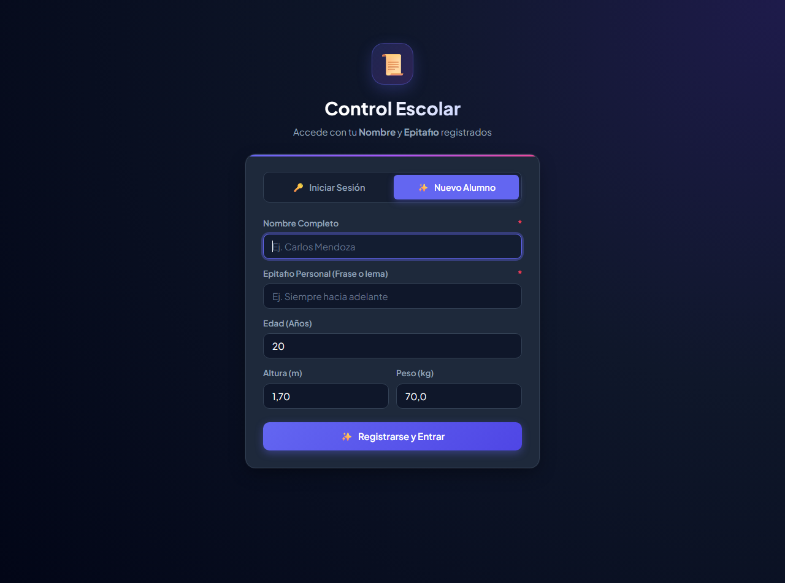
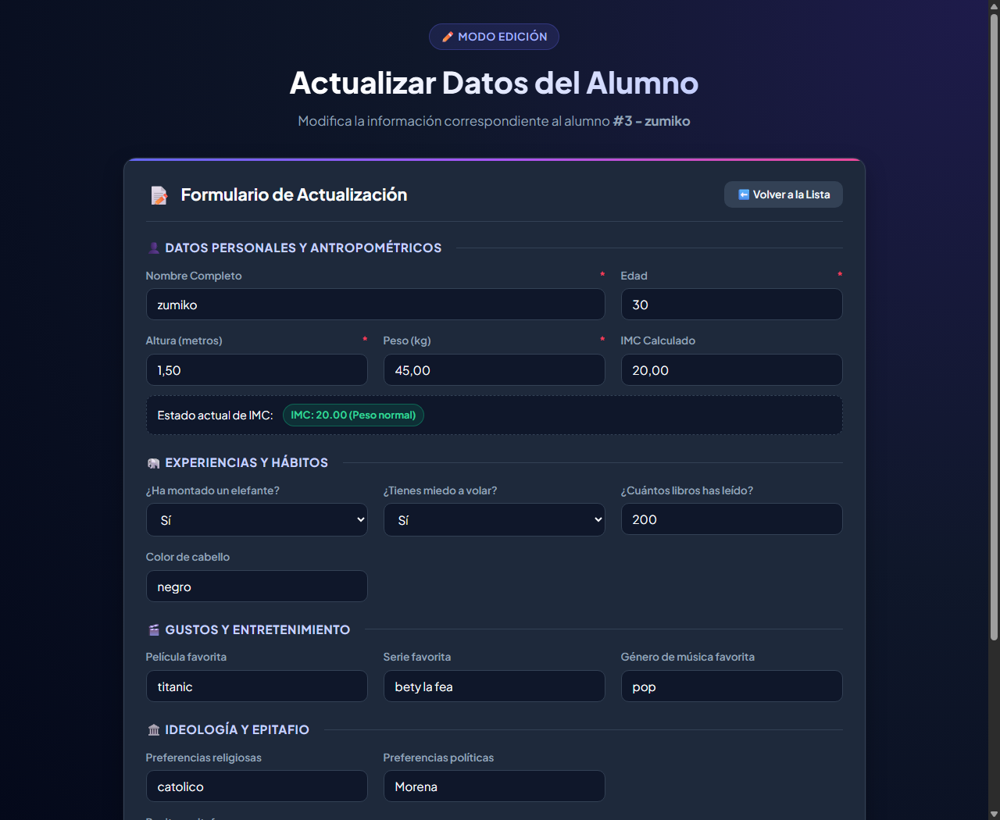

# 📘 Manual de Usuario y Guía Técnica del Sistema
## Sistema de Control Escolar y Gestión de Alumnos (CRUD)
**Versión:** 2.0 (Seguridad Robusta y Sentencias Preparadas)  
**Entorno de Ejecución:** XAMPP (Apache 2.4+ / PHP 8.x / MariaDB - MySQL)  
**Ubicación del Proyecto:** `http://localhost/Desarollo_web/Tarea/`

---

## 📑 Tabla de Contenidos
1. [Introducción y Objetivos](#1-introducción-y-objetivos)
2. [Requisitos del Sistema e Instalación](#2-requisitos-del-sistema-e-instalación)
3. [Estructura del Proyecto y Archivos](#3-estructura-del-proyecto-y-archivos)
4. [Guía de Uso Paso a Paso](#4-guía-de-uso-paso-a-paso)
   - 4.1. [Acceso al Sistema](#41-acceso-al-sistema)
   - 4.2. [Iniciar Sesión y Registrarse](#42-iniciar-sesión-y-registrarse)
   - 4.3. [Panel Principal (Dashboard)](#43-panel-principal-dashboard)
   - 4.4. [Registro de Nuevos Alumnos (Alta)](#44-registro-de-nuevos-alumnos-alta)
   - 4.5. [Consulta de Alumnos (Lectura)](#45-consulta-de-alumnos-lectura)
   - 4.6. [Modificación de Datos (Edición)](#46-modificación-de-datos-edición)
   - 4.7. [Eliminación de Alumnos (Baja)](#47-eliminación-de-alumnos-baja)
   - 4.8. [Cierre de Sesión](#48-cierre-de-sesión)
5. [Mejoras Técnicas y de Seguridad Implementadas](#5-mejoras-técnicas-y-de-seguridad-implementadas)
6. [Preguntas Frecuentes y Solución de Problemas](#6-preguntas-frecuentes-y-solución-de-problemas)

---

## 1. Introducción y Objetivos

El **Sistema de Control Escolar** es una aplicación web desarrollada en PHP y MySQL diseñada para la administración integral de registros estudiantiles. Proporciona una interfaz moderna, responsiva e intuitiva para gestionar tanto información antropométrica (edad, peso, altura, cálculo automático de Índice de Masa Corporal) como aspectos cualitativos y personales del alumno (epitafio, aficiones, lecturas y preferencias).

### Objetivos Principales:
* Permitir la gestión de las cuatro operaciones básicas de base de datos (**C**reate, **R**ead, **U**pdate, **D**elete).
* Implementar mecanismos de seguridad informática contra **Inyección SQL (SQLi)** mediante **Sentencias Preparadas (`Prepared Statements`)**.
* Proporcionar retroalimentación visual clara y validación estricta de datos antes del almacenamiento.

---

## 2. Requisitos del Sistema e Instalación

### Requisitos de Software:
* **XAMPP** para Windows (con versión de **PHP 8.0 o superior**).
* Servidor Web **Apache**.
* Servidor de Base de Datos **MySQL / MariaDB**.
* Navegador Web moderno (Chrome, Edge, Opera, Firefox).

### Pasos de Instalación y Puesta en Marcha:
1. **Copiar el Proyecto:** Asegurarse de que la carpeta `Tarea` se encuentre dentro del directorio raíz de XAMPP:
   ```
   C:\xampp\htdocs\Desarollo_web\Tarea\
   ```
2. **Iniciar Servicios:**
   * Abrir el panel de control de **XAMPP**.
   * Hacer clic en **Start** en el módulo **Apache**.
   * Hacer clic en **Start** en el módulo **MySQL**.
3. **Generación Automática de la Base de Datos:**
   * El sistema cuenta con migración automática en [connection.php](file:///c:/xampp/htdocs/Desarollo_web/Tarea/connection.php). Al acceder por primera vez, creará la base de datos `alumnos_crud` y la tabla `alumnos` si aún no existen.

---

## 3. Estructura del Proyecto y Archivos

| Archivo | Tipo | Descripción y Función |
| :--- | :--- | :--- |
| [connection.php](file:///c:/xampp/htdocs/Desarollo_web/Tarea/connection.php) | Backend | Administra la conexión a MySQL, crea la base de datos y define el juego de caracteres `utf8mb4`. |
| [login.php](file:///c:/xampp/htdocs/Desarollo_web/Tarea/login.php) | Vista / UI | Pantalla de bienvenida con pestañas para **Iniciar Sesión** o **Registrar Nuevo Alumno**. |
| [login_process.php](file:///c:/xampp/htdocs/Desarollo_web/Tarea/login_process.php) | Controlador | Procesa y valida las credenciales del alumno usando sentencias preparadas y crea la sesión PHP. |
| [logout.php](file:///c:/xampp/htdocs/Desarollo_web/Tarea/logout.php) | Controlador | Destruye la sesión del usuario de forma segura y redirige al login. |
| [index.php](file:///c:/xampp/htdocs/Desarollo_web/Tarea/index.php) | Vista Principal | Panel de control (Dashboard): muestra el formulario de alta y la tabla interactiva de alumnos. |
| [insert_alumno.php](file:///c:/xampp/htdocs/Desarollo_web/Tarea/insert_alumno.php) | Controlador | Calcula el IMC, valida los 15 campos y los inserta de forma parametrizada. |
| [update.php](file:///c:/xampp/htdocs/Desarollo_web/Tarea/update.php) | Vista / Formulario | Carga la información del alumno seleccionado mediante una consulta preparada para su edición. |
| [edit_alumno.php](file:///c:/xampp/htdocs/Desarollo_web/Tarea/edit_alumno.php) | Controlador | Recalcula el IMC y ejecuta la actualización (`UPDATE`) con sentencia preparada. |
| [delete_alumno.php](file:///c:/xampp/htdocs/Desarollo_web/Tarea/delete_alumno.php) | Controlador | Elimina de manera segura al alumno por su ID verificado. |
| [styles.css](file:///c:/xampp/htdocs/Desarollo_web/Tarea/styles.css) | Estilos | Hoja de estilos con paleta moderna, componentes tipo tarjeta, tipografías y efectos visuales. |

---

## 4. Guía de Uso Paso a Paso

### 4.1. Acceso al Sistema
Abre tu navegador de preferencia e ingresa la siguiente URL:
```
http://localhost/Desarollo_web/Tarea/
Si no has iniciado sesión previamente, serás redirigido automáticamente a `login.php`.

---

### 4.2. Iniciar Sesión y Registrarse

#### Pestaña 1: Iniciar Sesión (Alumnos Registrados)


1. Ingresa tu **Nombre** tal como fue registrado (ejemplo: `Juan Pérez`).
2. Ingresa tu **Epitafio Personal** correspondiente (actúa como clave personal).
3. Haz clic en el botón **"Acceder al Panel"**.
4. Si los datos son correctos, entrarás al panel principal. Si los datos no coinciden, el sistema mostrará una alerta indicando que verifiques tus datos.

#### Pestaña 2: Nuevo Alumno (Registro Rápido)


1. Si eres nuevo en el sistema, haz clic en la pestaña **"✨ Nuevo Alumno"**.
2. Llena los campos requeridos:
   * Nombre Completo.
   * Edad.
   * Altura (en metros o centímetros, el sistema lo ajusta automáticamente).
   * Peso (en kilogramos).
   * Epitafio Personal.
3. Haz clic en **"Registrar y Entrar"**. El sistema calculará tu IMC, guardará tus datos y abrirá tu sesión automáticamente.

---

### 4.3. Panel Principal (Dashboard)


Al iniciar sesión se visualiza:
* **Barra de Estado:** Muestra tu nombre, insignia con tu epitafio y el botón de **Cerrar Sesión**.
* **Contador de Alumnos:** Indica el número total de registros existentes en la base de datos.
* **Formulario de Registro (Izquierda):** Para agregar nuevos alumnos de forma completa con todos sus datos antropométricos y de ocio.
* **Tabla de Alumnos (Derecha):** Listado detallado con botones de acción para **Editar** y **Eliminar**.

---

### 4.4. Registro de Nuevos Alumnos (Alta)
Para registrar un alumno completo desde el panel principal:
1. En la sección **"Registrar Nuevo Alumno"**, completa los campos:
   * **Nombre Completo:** Obligatorio.
   * **Edad:** Valor numérico en años.
   * **Altura:** En metros (ej. `1.75`) o en centímetros (ej. `175`). El sistema normaliza el valor.
   * **Peso:** En kilogramos (ej. `70.5`).
   * **Preferencia Religiosa, Política, Miedos y Hábitos:** Selección y campos de texto.
   * **Epitafio:** Texto descriptivo o lema del alumno.
2. Haz clic en **"Guardar Alumno"**.
3. El sistema calcula en milisegundos el **IMC**, almacena el registro y actualiza la lista al instante.

---

### 4.5. Consulta de Alumnos (Lectura)
En la tabla del panel se observan las columnas:
* **ID:** Identificador numérico único autoincremental.
* **Nombre y Edad:** Con avatar gráfico.
* **IMC y Estado Físico:** Con etiquetas de color según la categoría (Bajo peso, Normal, Sobrepeso, Obesidad).
* **Gustos y Preferencias:** Películas, libros leídos, música.
* **Epitafio:** Texto personalizado.
* **Acciones:** Botón azul (✏️ Editar) y botón rojo (🗑️ Eliminar).

---

### 4.6. Modificación de Datos (Edición)


1. En la fila del alumno que deseas modificar, haz clic en el botón azul **"✏️ Editar"**.
2. Serás dirigido a `update.php` donde todos los campos estarán precargados con la información actual del alumno.
3. Realiza los cambios necesarios (por ejemplo, corregir la altura o actualizar el peso).
4. Haz clic en **"Guardar Cambios"**.
5. El sistema recalcula el nuevo IMC y te devolverá a la tabla principal con los datos actualizados.

---

### 4.7. Eliminación de Alumnos (Baja)
1. En la fila del alumno que deseas dar de baja, haz clic en el botón rojo **"🗑️ Eliminar"**.
2. El navegador solicitará una confirmación preventiva para evitar borrados accidentales:
   > *"¿Estás seguro de que deseas eliminar este alumno? Esta acción no se puede deshacer."*
3. Al confirmar, el registro se eliminará de forma segura de la base de datos.

---

### 4.8. Cierre de Sesión
Para salir del sistema de forma segura, haz clic en el botón **"🚪 Cerrar Sesión"** ubicado en la esquina superior derecha. Esto destruye la variable `$_SESSION`, impidiendo que terceros puedan acceder al panel utilizando el botón de regreso del navegador.

---

## 5. Mejoras Técnicas y de Seguridad Implementadas

En esta versión se incorporaron los estándares de seguridad implementados en el módulo `CRUD_php`:

### 1. Cifrado Seguro de Contraseñas / Epitafio (`password_hash` y `password_verify`)
Dado que el **Epitafio Personal** actúa como la contraseña / clave de acceso del alumno, ahora se almacena de forma irreversible usando el algoritmo seguro **Bcrypt** con costo variable (`PASSWORD_DEFAULT`):
```php
// Al registrar o actualizar:
$recitar_epitafio_hashed = password_hash($recitar_epitafio, PASSWORD_DEFAULT);

// Al iniciar sesión en login_process.php:
if (password_verify($epitafio, $row['recitar_epitafio'])) {
    $authenticated = true;
}
```
Además, se incluye migración transparente: si una cuenta antigua tenía el epitafio en texto plano, al iniciar sesión se verifica y se actualiza automáticamente a hash seguro sin interrumpir al alumno.

### 2. Sentencias Preparadas (`Prepared Statements`)
En lugar de concatenar variables directamente en las consultas SQL (lo cual es vulnerable a inyecciones SQL), todas las consultas críticas se ejecutan con sentencias parametrizadas:
```php
// Ejemplo en login_process.php
$sql = "SELECT * FROM alumnos WHERE LOWER(TRIM(nombre)) = LOWER(?)";
$stmt = $con->prepare($sql);
$stmt->bind_param("s", $nombre);
$stmt->execute();
```

### 2. Tipado Estricto de Parámetros (`bind_param`)
Los datos entrantes se vinculan respetando su naturaleza técnica:
* `"s"` para texto (nombre, preferencias, epitafio).
* `"i"` para enteros (edad, libros leídos, ID).
* `"d"` para decimales / flotantes (altura, peso, imc).

### 3. Normalización y Cálculo Preciso del IMC
El sistema detecta automáticamente si el usuario ingresó la altura en centímetros (ejemplo: `178`) y la convierte a metros (`1.78`), calculando el IMC con la fórmula estándar:
$$\text{IMC} = \frac{\text{peso}}{\text{altura}^2}$$

### 4. Liberación de Recursos y Redirección Segura
Cada sentencia y conexión abierta se cierra explícitamente (`$stmt->close()` y `$con->close()`), y cada instrucción de redirección (`header("Location: ...")`) va acompañada inmediatamente de `exit()` para garantizar que el script no continúe ejecutando código en segundo plano.

---

## 6. Preguntas Frecuentes y Solución de Problemas

### ❓ P: Al abrir el sistema aparece "Error de conexión a MySQL".
**R:** Asegúrate de que el servicio **MySQL** esté activo en el panel de control de XAMPP. Haz clic en **Start** junto a MySQL.

### ❓ P: ¿Qué ocurre si un alumno escribe su nombre con mayúsculas o minúsculas distintas al registrarse?
**R:** El sistema utiliza las funciones `LOWER(TRIM(...))` en la consulta preparada, permitiendo que el alumno inicie sesión sin importar si utilizó mayúsculas, minúsculas o espacios accidentales al inicio o al final de su nombre.

### ❓ P: ¿Cómo se protegen los caracteres especiales y acentos?
**R:** El archivo [connection.php](file:///c:/xampp/htdocs/Desarollo_web/Tarea/connection.php) establece explícitamente `utf8mb4` en la conexión, asegurando que nombres con tildes (como *Ángel* o *Gómez*) y símbolos no se corrompan en la base de datos.

---
*Manual elaborado para el proyecto de Desarrollo Web - Control Escolar.*
